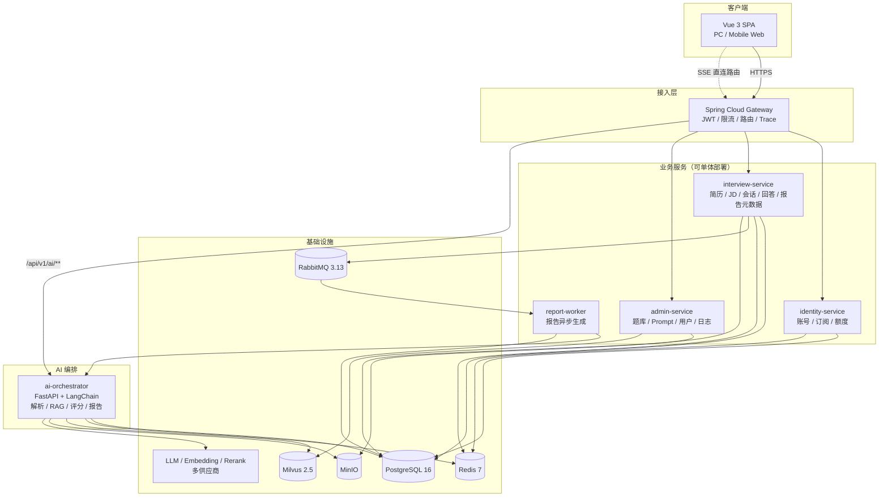
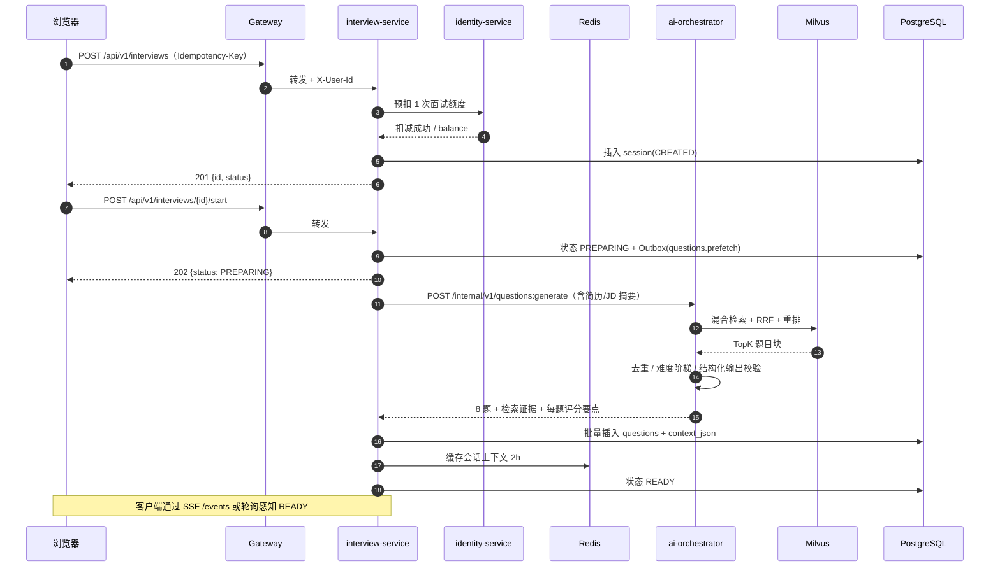
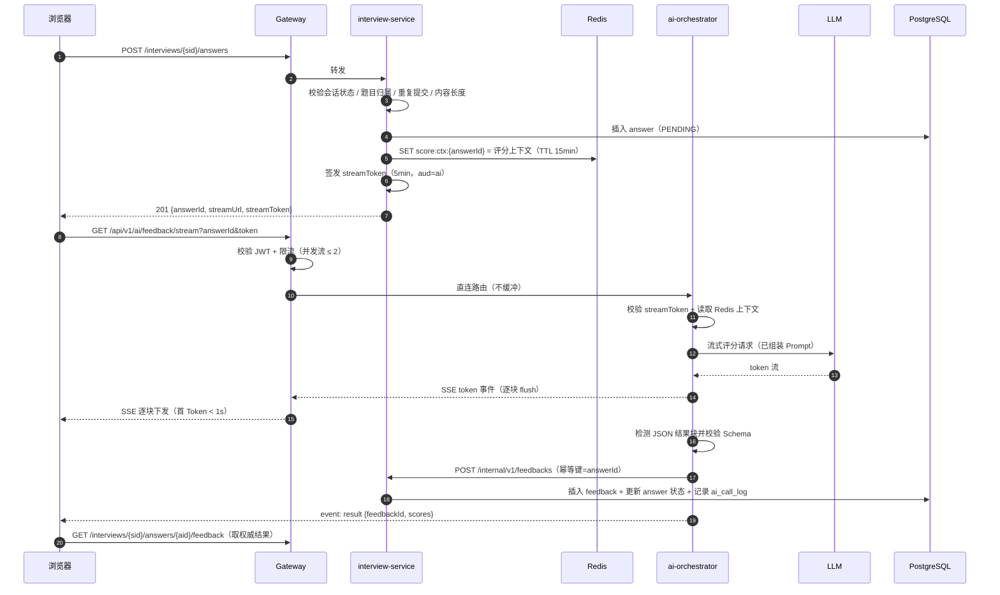
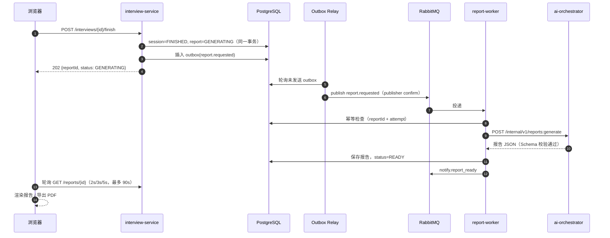

# 系统架构

> 状态：生效 ｜ 版本：v1.2 ｜ 更新：2026-11-07
> 关联：[数据模型](./data-model.md)、[后端规范](../dev/backend.md)

## 1. 架构目标

1. **可讲的拆分**：既能体现微服务治理，又避免“为了拆而拆”导致本地跑不起来。
2. **流式优先**：评分链路以最小跳数直达模型，首 Token 可度量、可优化。
3. **AI 与业务解耦**：Prompt、RAG、评测集中在 Python 服务，Java 侧不重复维护 Prompt。
4. **可演进**：MVP 以多模块单体部署，出现明确瓶颈后按边界拆出独立服务。
5. **可观测**：每个请求可追踪，每次 AI 调用可核算 Token 与成本。

## 2. 架构决策记录（ADR）

### ADR-001 前端采用 Vue 3 而非 React

- **决策**：Vue 3.5 + TypeScript + Vite + Pinia + Vue Router + Tailwind。
- **理由**：需求以表单、会话流、图表为主，Vue SFC 开发密度高；shadcn-vue 提供可复制源码的 headless 组件；团队若无 React 沉淀，Vue 学习成本更低。
- **代价**：复杂状态编排生态弱于 React，用 `@tanstack/vue-query` + composable 补齐。

### ADR-002 业务后端采用 Spring Boot 多模块单体，预留微服务拆分

- **决策**：一个 Maven 父工程，模块 `identity`、`interview`、`admin`、`report-worker`、`common`、`ai-client`；MVP 可打成一个可执行 Jar（`app` 聚合模块），也可按模块独立启动。
- **理由**：本地开发、事务、调试成本最低；模块边界用 ArchUnit 强制，后续拆服务只需换传输层。
- **拆分触发条件**：单模块 QPS > 500、独立扩容需求明确、团队 > 6 人、发布频率冲突。

### ADR-003 AI 编排独立为 Python FastAPI 服务

- **决策**：简历/JD 结构化、RAG 出题、评分、报告生成均由 `ai-orchestrator` 承担。
- **理由**：LangChain、pymilvus、FlagEmbedding、ragas 等生态在 Python；Prompt 与离线评测同仓，避免跨语言漂移。
- **代价**：多语言运维；通过 OpenAPI 契约、统一 Trace、契约测试降低风险。

### ADR-004 LangChain4j 只做轻量场景

- **决策**：Java 侧使用 LangChain4j 实现：报告文案润色、管理端 Prompt 试跑、AI 服务不可用时的降级评分（非流式、固定模板）。
- **理由**：保留“Java + LangChain4j”技术展示，又不产生第二套评分 Prompt。
- **约束**：评分权威实现仅在 Python；Java 降级结果标记 `degraded=true`，不计入 A/B 实验。

### ADR-005 PostgreSQL + JSONB 作为唯一业务事实源

- **决策**：用户、会话、题目、回答、反馈、报告元数据、Prompt 版本、调用日志全部落 PG；结构化简历/JD 用 JSONB。
- **理由**：减少组件；JSONB + GIN 足以支撑半结构化查询；事务保证额度与状态一致。
- **约束**：JSONB 只存“整体读取”的结构，不把需要高频过滤的字段埋进 JSON。

### ADR-006 Milvus 2.5 承担题库向量检索

- **决策**：Collection 按题库版本建，别名切换；稠密 + 稀疏混合检索 + RRF，再接重排。
- **理由**：题库规模 10 万级仍可单机 Standalone；混合检索显著提升术语类查询召回；避免 ES + 向量库双栈。

### ADR-007 流式链路网关直连 AI 服务

- **决策**：`GET /api/v1/ai/feedback/stream` 由 Gateway 直接路由到 `ai-orchestrator`，不经过 `interview-service`。
- **理由**：少一次代理转发，降低 TTFT 和故障面；评分所需上下文由 `interview-service` 预写入 Redis，AI 服务直接读取。
- **安全**：Gateway 校验用户 JWT；`interview-service` 额外签发 5 分钟 `streamToken`（aud=ai），AI 服务双校验。

### ADR-008 RabbitMQ + 事务性 Outbox

- **决策**：报告生成、通知等异步任务走 RabbitMQ；业务写库与消息发送通过 Outbox 表解耦。
- **理由**：避免“数据库提交成功但消息没发出去”；消费者幂等，支持重试与死信。

### ADR-009 文件走 MinIO，预签名直传为后续优化

- **决策**：MVP 由后端接收 multipart 后转存 MinIO；V1.1 改为前端预签名直传 + 后端回调。
- **理由**：MVP 简单可控；直传可降低大文件对应用服务器的内存压力。

### ADR-010 部署：Compose 开发、K8s 生产

- **决策**：`docker-compose.yml` 一键起全栈；生产用 Helm Chart，Ingress 关闭缓冲以支持 SSE。
- **理由**：开发者体验与生产弹性兼顾；K8s 的 HPA 可应对晚间练习高峰。

## 3. 逻辑架构



**关键点**：

- 浏览器只访问 Gateway，不直接访问内部服务。
- SSE 路由在 Gateway 终止 TLS 后以 HTTP/1.1 chunked 透传，禁止响应体聚合。
- `ai-orchestrator` 不暴露公网，仅接受 Gateway 与 `report-worker` 的内部调用。
- Milvus 的写入只发生在题库发布/重建索引流程，面试期间只读。

## 4. 服务职责与边界

| 服务 | 拥有的数据 | 对外职责 | 明确不负责 |
|---|---|---|---|
| identity-service | `app_user`、`user_quota`、`quota_ledger`、`subscription`、`order` | 注册登录、Token、额度预扣/返还、套餐 | 面试状态、题目内容 |
| interview-service | `resume`、`job_description`、`interview_session`、`interview_question`、`interview_answer`、`answer_feedback`、`interview_report` | 会话状态机、题目编排、回答落库、报告元数据、上下文快照 | 直接调用 LLM、向量检索 |
| admin-service | `question_bank`、`prompt_template/version`、`ab_experiment`、`ai_call_log`（只读） | 题库与 Prompt 管理、实验配置、日志查询、补额度入口 | 用户密码、支付回调 |
| ai-orchestrator | 无业务主数据（只写反馈/日志/报告草稿） | 解析、RAG、出题、评分流、报告生成、评测 | 额度扣减、会话状态推进 |
| report-worker | 无独立表（读写报告表） | 消费报告任务、重试、PDF 生成、通知 | 接收用户请求 |

**边界规则**：

1. 跨服务只通过 API 或事件，不共享数据库表。
2. `interview-service` 是会话状态的唯一写入者；AI 服务只能通过回调更新反馈与报告草稿。
3. 额度变更只能由 `identity-service` 执行；其他服务通过内部接口请求。

## 5. 核心时序

### 5.1 创建并开始面试（出题）



**降级**：AI 出题失败时，从题库按维度随机抽题（跳过重排），仍失败则返回 `QUESTION_GEN_FAILED` 并全额返还额度。

### 5.2 提交回答并流式评分



**为什么能做到首字快**：

1. 评分所需简历/JD 摘要与检索证据在出题阶段已生成，提交回答时只做一次 Redis 写入。
2. SSE 请求不查业务库、不做 RAG、不做额度扣减（额度在提交时已处理）。
3. 网关直连 AI 服务，中间无第二个 Java 代理。
4. 模型使用流式输出，服务端每收到一块立即 flush，不做整段缓冲。

### 5.3 报告异步生成



**一致性**：Outbox Relay 每 500ms 扫描一次；消息消费幂等；重复消费不会产生重复报告。重试 3 次后进入死信，报告状态置 `FAILED` 并允许手动重试。

## 6. 模块与包结构

```
offercCoach/
├── backend/                         # Maven 多模块
│   ├── pom.xml
│   ├── oc-common/                   # 错误码、结果封装、Trace、工具
│   ├── oc-ai-client/                # 调用 Python AI 服务的客户端 + LangChain4j
│   ├── oc-identity/                 # 账号、订阅、额度
│   ├── oc-interview/                # 简历、JD、会话、回答、报告
│   ├── oc-admin/                    # 题库、Prompt、日志
│   ├── oc-report-worker/            # MQ 消费者
│   ├── oc-gateway/                  # Spring Cloud Gateway
│   └── oc-app/                      # 聚合启动模块（MVP 单体部署）
├── ai-orchestrator/                 # Python FastAPI
│   ├── app/
│   │   ├── api/                     # internal 路由
│   │   ├── chains/                  # parse / match / question / score / report
│   │   ├── rag/                     # embed / retrieve / rerank / eval
│   │   ├── prompts/                 # 模板文件（只读挂载）
│   │   ├── clients/                 # LLM / Milvus / Redis / PG
│   │   └── core/                    # 配置、日志、鉴权、限流
│   ├── eval/                        # 黄金集与评测脚本
│   └── pyproject.toml
├── frontend/                        # Vue 3
├── deploy/
│   ├── docker-compose.yml
│   ├── helm/offercCoach/
│   └── sql/                         # Flyway 之外的初始化脚本
└── docs/
```

**依赖规则（ArchUnit 强制）**：

- `oc-common` 不依赖任何业务模块。
- `oc-identity`、`oc-interview`、`oc-admin` 互不依赖，跨域调用走 `oc-ai-client` 之外的内部 HTTP 客户端或事件。
- Controller 不得直接依赖 Repository；Application Service 不得返回 Entity。
- `oc-gateway` 只依赖 `oc-common`。

## 7. 数据流与状态归属

| 数据 | 写入方 | 读取方 | 一致性要求 |
|---|---|---|---|
| 用户与额度 | identity | 全部服务（通过 API） | 强一致（行锁 + 流水） |
| 简历/JD | interview | interview、ai-orchestrator（快照） | 强一致 + 快照不可变 |
| 会话/题目/回答 | interview | interview、report-worker | 强一致 |
| 评分反馈 | ai-orchestrator 回调写入 | interview、admin | 最终一致（秒级） |
| 报告 | report-worker | interview、前端 | 最终一致（30s 内） |
| Prompt 版本 | admin | ai-orchestrator（拉取/缓存） | 最终一致（30s 缓存） |
| 调用日志 | ai-orchestrator | admin、监控 | 最终一致（异步批量写） |

## 8. 容量估算（MVP → 1 万 DAU）

| 指标 | MVP 假设 | 1 万 DAU | 说明 |
|---|---|---|---|
| 日会话数 | 200 | 3,000 | 人均 0.3 场 |
| 峰值并发 SSE | 30 | 300 | 晚间 20:00–22:00，约 10% 在线用户 |
| 单场 Token | 35k–45k | 同左 | 出题 + 8 次评分 + 报告 |
| 日 Token | 4M | 60M | 含重试与摘要 |
| PG 增长 | 1 GB/月 | 15 GB/月 | 日志分区 + 归档 |
| 向量规模 | 5 千题 / 2 万块 | 5 万题 / 20 万块 | 单机 Milvus 足够 |
| 对象存储 | 2 GB/月 | 30 GB/月 | 简历 + PDF，180 天生命周期 |

**扩容顺序**：`ai-orchestrator`（无状态）→ `interview-service` → Gateway → PG 读副本 → Milvus 集群。

## 9. 降级与容错策略

| 故障 | 检测 | 降级行为 | 用户感知 |
|---|---|---|---|
| LLM 超时（> 8s 首 Token） | 客户端 + 服务端超时 | 切换备用供应商/小模型 | “正在切换线路” |
| LLM 全部不可用 | 熔断器打开 | 返回模板化反馈（仅规则评分），标记 `degraded` | 可继续作答，提示质量下降 |
| Milvus 不可用 | 健康检查 | 跳过后检索，仅用题库随机 + 生成题 | 题目针对性下降 |
| Redis 不可用 | 连接异常 | 流式上下文改走内部 HTTP 获取；限流退化为本地令牌桶 | 首字略慢 |
| RabbitMQ 不可用 | Outbox 积压 | 报告改为同步生成（限流）或延迟 | 报告变慢 |
| ASR 失败 | 回调错误 | 提示手动输入，额度不重复扣 | 可继续 |
| 报告生成失败 | 3 次重试后 | 标记 FAILED + 手动重试入口 | 可重试 |

**熔断参数**：失败率 > 50% 且样本 ≥ 20 时打开，30s 半开；单次请求超时：首 Token 10s、总时长 90s（评分与报告）。

## 10. 技术选型清单

| 层 | 选型 | 版本基线 |
|---|---|---|
| 前端 | Vue、Vite、TypeScript、Tailwind、Pinia、Vue Router、TanStack Query | Vue 3.5 / Vite 6 / TS 5.6 |
| UI | shadcn-vue、Reka UI、lucide-vue-next、ECharts | 最新稳定 |
| 网关 | Spring Cloud Gateway | Spring Cloud 2023.0.3（Leyton） |
| 业务 | Spring Boot、Spring Security、MyBatis-Plus、Flyway、MapStruct | Boot 3.3.5 |
| AI(Java) | LangChain4j | 1.0.x |
| AI(Python) | FastAPI、LangChain、pydantic、pymilvus、sentence-transformers | Python 3.12 |
| 数据库 | PostgreSQL | 16 |
| 缓存 | Redis | 7.2 |
| 消息 | RabbitMQ | 3.13（quorum queue） |
| 向量 | Milvus | 2.5 |
| 对象存储 | MinIO | 最新稳定 |
| 观测 | OpenTelemetry、Prometheus、Grafana、Loki、Tempo | — |
| 部署 | Docker、Compose、K8s、Helm | — |

> 版本以团队锁定为准；升级需走 ADR，不在业务迭代中顺手升级大版本。

- **版本配对**：Boot 3.3.5 对应 Spring Cloud 2023.0.3；Cloud 2024 需整体升级 Boot 3.4，另开 ADR。
- **网关边界**：`/internal/**` 禁止公网入站；`pb/pt/pv/df` 作为网关访问策略（见 [api.md](./api.md) §1.7），不写进 URL；灰度按 Header/用户分桶，SSE 灰度切换前先排空旧流。

## 11. 安全架构要点

- 边界：公网只暴露 Gateway；管理端路径额外要求 `ADMIN` 角色 + IP 白名单（生产）。
- 鉴权：JWT（RS256）短时效 + Refresh 轮换；内部服务使用 mTLS 或短期服务 Token。
- 输入：文件类型双校验、大小限制、病毒扫描；JD/简历作为不可信文本定界包裹。
- 输出：LLM 返回 Markdown 经 DOMPurify 白名单渲染；禁止 `v-html` 直接渲染未净化内容。
- 数据：PG 敏感列加密；MinIO 私有桶 + 预签名；日志脱敏。
- 审计：管理端所有写操作记录操作者、前后值、IP、TraceId。

## 12. 架构风险

1. **Python 与 Java 双栈**：用 OpenAPI + 契约测试 + 统一 Trace 控制；任何字段变更需双端同步发布。
2. **SSE 长连接占用**：网关与 Ingress 连接数上限需压测；设置单用户并发流上限与空闲超时。
3. **Milvus 运维复杂度**：MVP 用 Standalone；数据可从 PG 题库重建，允许“删库重建”作为兜底。
4. **Prompt 漂移**：Prompt 文件版本化、启动时校验哈希、发布走评测门禁。
5. **成本失控**：预算按用户/会话/全局三级熔断，超出即降级而非静默失败。
