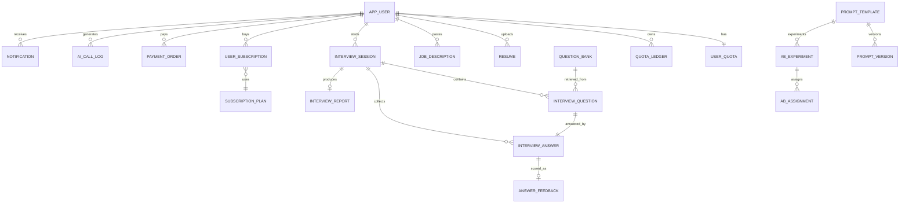

# 数据模型与存储

> 状态：生效 ｜ 版本：v1.3 ｜ 更新：2026-11-07
> 关联：[架构](./architecture.md)、[后端规范](../dev/backend.md)

## 1. 设计原则

1. **PostgreSQL 是唯一事实源**：额度、会话状态、报告状态以 PG 为准，Redis 只做加速与短时上下文。
2. **金额用分、分数用 numeric**：禁止 `float` 参与结算与排序。
3. **枚举用 VARCHAR + CHECK**：便于演进，禁止 PostgreSQL 原生 ENUM（改值成本高）。
4. **软删除只用于用户可见资源**：`resume`、`app_user`；流水与日志不删除。
5. **大字段分离**：回答正文、结构化 JSON 存 PG；原文件、音频、PDF 存 MinIO。
6. **可变表带 `created_at/updated_at`**：append-only 表（流水、日志、调用记录）只需 `created_at`；时间值统一 `TIMESTAMPTZ`。
7. **迁移用 Flyway**：命名 `V{yyyyMMddHHmm}__{description}.sql`，遵循 expand → migrate → contract。

### 1.1 命名与类型硬规则

| 对象 | 规则 | 示例 |
|---|---|---|
| 表名 | 小写 `snake_case`、**单数**、语义完整；不缩写 | `interview_session`、`answer_feedback` |
| 列名 | 小写 `snake_case`、完整单词；引用列 `*_id`；布尔列用 `is_*` / `has_*` | `question_id`、`is_default` |
| 主键 | `id BIGINT`；MVP 用 identity，出参序列化为字符串 | `id` |
| 时间 | 时间点一律 `TIMESTAMPTZ`；纯日期用 `DATE`；业务时间独立成列 | `finished_at`、`expires_at` |
| 金额 | 整数分（`*_cents INT/BIGINT`）；分数/比例用 `NUMERIC`；禁止 `FLOAT/DOUBLE` | `amount_cents`、`overall_score NUMERIC(3,1)` |
| 枚举 | `VARCHAR + CHECK`（本项与参考仓库的 `SMALLINT` 不同，优先可读性与演进成本） | `status IN ('READY','FAILED')` |
| JSONB | 只存“整体读取、不按内部字段高频过滤”的结构；需过滤/排序的字段独立成列 | `structured_json`、`config` |
| 外键 | 核心引用保留外键；跨服务不共享表、不做跨服务 JOIN；删除策略见 §11 | `REFERENCES interview_session(id)` |
| 索引 | `idx_<table>_<cols>` / `uq_<table>_<cols>`；只建真实查询路径 | `idx_interview_session_user_time` |
| 注释 | 新增表/列必须有 `COMMENT ON`；枚举列写码值语义 | `COMMENT ON COLUMN ... IS '状态 1草稿 2...'` |

**存量偏差**：首版 DDL 的部分索引使用短名（如 `idx_user_status`、`idx_question_filter`）。新增或重建索引按完整规则命名；存量不顺手改名，需要时单独走迁移。

### 1.2 软删与唯一键

- 形态：`deleted_at TIMESTAMPTZ`（NULL = 未删除）；可选 `deleted_by BIGINT`。只用于用户可见、需要恢复的资源（`resume`、`app_user`）。
- 查询：`WHERE deleted_at IS NULL`；软删行**不占唯一键**，用部分唯一索引：
  `CREATE UNIQUE INDEX uq_resume_file ON resume(user_id, sha256) WHERE deleted_at IS NULL;`
- 流水、日志、调用记录、消息表不做软删；生命周期由保留期与清理任务控制。
- 软删表必须有删除入口；没有删除入口的表不加软删列。

### 1.3 建表 / 改表自查清单

1. 表名单数、语义完整；是否与已有表职责重叠？
2. 主键、`created_at`、必要的 `updated_at` 是否齐全？append-only 是否只保留 `created_at`？
3. 金额/数量/分数是否用 `NUMERIC` 或整数分？有没有 `FLOAT`？
4. 枚举是否 `VARCHAR + CHECK`？码值是否写入注释与文档？
5. 需要过滤/排序的字段是否独立成列？JSONB 是否只用于整体读取？
6. 唯一约束是否考虑软删（部分唯一索引）？索引是否对应真实查询？
7. 外键与删除策略是否明确？是否跨服务引用（禁止）？
8. 是否写 `COMMENT ON TABLE/COLUMN`？
9. 迁移是否遵循 expand → contract？是否可在旧版本应用下运行？
10. 是否更新本文 DDL、ER 图与 `requirements.md` 的相关条目？

## 2. ER 总览



## 3. 账号与商业化

```sql
CREATE EXTENSION IF NOT EXISTS citext;
CREATE EXTENSION IF NOT EXISTS pgcrypto;
CREATE EXTENSION IF NOT EXISTS pg_trgm;

CREATE TABLE app_user (
    id                BIGINT GENERATED BY DEFAULT AS IDENTITY PRIMARY KEY,
    email             CITEXT,
    phone             VARCHAR(512),              -- 应用层 AES-GCM 密文（Base64），不存明文
    phone_hash        CHAR(64),
    password_hash     VARCHAR(255) NOT NULL,
    nickname          VARCHAR(40) NOT NULL,
    avatar_url        TEXT,
    role              VARCHAR(16) NOT NULL DEFAULT 'USER'
                      CHECK (role IN ('USER','SUPPORT','ADMIN')),
    status            VARCHAR(16) NOT NULL DEFAULT 'ACTIVE'
                      CHECK (status IN ('ACTIVE','LOCKED','DISABLED','DELETED')),
    timezone          VARCHAR(64) NOT NULL DEFAULT 'Asia/Shanghai',
    email_verified_at TIMESTAMPTZ,
    last_login_at     TIMESTAMPTZ,
    failed_login_count SMALLINT NOT NULL DEFAULT 0,
    locked_until      TIMESTAMPTZ,
    invite_code       VARCHAR(16),               -- 个人邀请码；注册后生成，唯一
    referred_by       BIGINT REFERENCES app_user(id),
    signup_ip         VARCHAR(64),
    signup_device_hash CHAR(64),                 -- 设备指纹 SHA-256，仅注册时写入
    allow_raw_resume_to_llm BOOLEAN NOT NULL DEFAULT true,
    created_at        TIMESTAMPTZ NOT NULL DEFAULT now(),
    updated_at        TIMESTAMPTZ NOT NULL DEFAULT now(),
    deleted_at        TIMESTAMPTZ,
    CHECK (email IS NOT NULL OR phone_hash IS NOT NULL OR status = 'DELETED')
);
CREATE INDEX idx_user_status ON app_user(status) WHERE deleted_at IS NULL;
-- 唯一性由部分索引保证：软删行不占用邮箱/手机号，允许注销后重新注册。
CREATE UNIQUE INDEX uq_app_user_email_active
    ON app_user(email) WHERE deleted_at IS NULL;
CREATE UNIQUE INDEX uq_app_user_phone_hash_active
    ON app_user(phone_hash) WHERE deleted_at IS NULL;

CREATE TABLE user_quota (
    user_id             BIGINT PRIMARY KEY REFERENCES app_user(id),
    plan_code           VARCHAR(32) NOT NULL DEFAULT 'FREE',
    interview_credits   INT NOT NULL DEFAULT 0 CHECK (interview_credits >= 0),
    resume_credits      INT NOT NULL DEFAULT 0 CHECK (resume_credits >= 0),
    period_start        DATE,
    period_end          DATE,
    daily_session_date  DATE,
    daily_session_count INT NOT NULL DEFAULT 0,
    updated_at          TIMESTAMPTZ NOT NULL DEFAULT now(),
    version             INT NOT NULL DEFAULT 0
);

CREATE TABLE quota_ledger (
    id              BIGINT GENERATED BY DEFAULT AS IDENTITY PRIMARY KEY,
    user_id         BIGINT NOT NULL REFERENCES app_user(id),
    quota_type      VARCHAR(16) NOT NULL CHECK (quota_type IN ('INTERVIEW','RESUME')),
    delta           INT NOT NULL CHECK (delta <> 0),
    balance_after   INT NOT NULL CHECK (balance_after >= 0),
    reason          VARCHAR(32) NOT NULL,
    ref_type        VARCHAR(24),
    ref_id          BIGINT,
    idempotency_key VARCHAR(128) NOT NULL,
    created_at      TIMESTAMPTZ NOT NULL DEFAULT now(),
    UNIQUE (user_id, idempotency_key)
);
CREATE INDEX idx_quota_ledger_user_time ON quota_ledger(user_id, created_at DESC);

-- 邀请奖励（每被邀请人唯一）与单行运行时策略（V202611080002）
CREATE TABLE invite_reward (
    id                         BIGINT GENERATED BY DEFAULT AS IDENTITY PRIMARY KEY,
    inviter_id                 BIGINT NOT NULL REFERENCES app_user(id),
    invitee_id                 BIGINT NOT NULL UNIQUE REFERENCES app_user(id),
    inviter_interview_credits  INT NOT NULL DEFAULT 0,
    invitee_resume_credits     INT NOT NULL DEFAULT 0,
    created_at                 TIMESTAMPTZ NOT NULL DEFAULT now()
);
CREATE INDEX idx_invite_reward_inviter_time ON invite_reward(inviter_id, created_at DESC);

CREATE TABLE platform_settings (
    id                             SMALLINT PRIMARY KEY CHECK (id = 1),
    registration_open              BOOLEAN NOT NULL DEFAULT true,
    daily_interview_limit          INT NOT NULL DEFAULT 3,
    daily_resume_limit             INT NOT NULL DEFAULT 3,
    free_monthly_interviews        INT NOT NULL DEFAULT 3,
    free_monthly_resumes           INT NOT NULL DEFAULT 3,
    invite_reward_inviter_interview INT NOT NULL DEFAULT 1,
    invite_reward_invitee_resume    INT NOT NULL DEFAULT 1,
    invite_daily_cap               INT NOT NULL DEFAULT 3,
    invite_total_cap               INT NOT NULL DEFAULT 20,
    registration_ip_daily_cap      INT NOT NULL DEFAULT 20,
    registration_device_daily_cap  INT NOT NULL DEFAULT 3,
    updated_by                     BIGINT REFERENCES app_user(id),
    updated_at                     TIMESTAMPTZ NOT NULL DEFAULT now()
);

CREATE TABLE subscription_plan (
    code              VARCHAR(32) PRIMARY KEY,
    name              VARCHAR(64) NOT NULL,
    price_cents       INT NOT NULL CHECK (price_cents >= 0),
    period_days       INT NOT NULL,
    interview_credits INT NOT NULL,
    resume_credits    INT NOT NULL,
    features          JSONB NOT NULL DEFAULT '{}'::jsonb,
    active            BOOLEAN NOT NULL DEFAULT true
);

CREATE TABLE user_subscription (
    id          BIGINT GENERATED BY DEFAULT AS IDENTITY PRIMARY KEY,
    user_id     BIGINT NOT NULL REFERENCES app_user(id),
    plan_code   VARCHAR(32) NOT NULL REFERENCES subscription_plan(code),
    status      VARCHAR(16) NOT NULL CHECK (status IN ('ACTIVE','EXPIRED','CANCELED')),
    started_at  TIMESTAMPTZ NOT NULL,
    expires_at  TIMESTAMPTZ NOT NULL,
    auto_renew  BOOLEAN NOT NULL DEFAULT false,
    created_at  TIMESTAMPTZ NOT NULL DEFAULT now()
);
CREATE UNIQUE INDEX uq_user_active_subscription
    ON user_subscription(user_id) WHERE status = 'ACTIVE';

CREATE TABLE payment_order (
    id              BIGINT GENERATED BY DEFAULT AS IDENTITY PRIMARY KEY,
    order_no        VARCHAR(40) NOT NULL UNIQUE,
    user_id         BIGINT NOT NULL REFERENCES app_user(id),
    plan_code       VARCHAR(32) NOT NULL,
    amount_cents    INT NOT NULL CHECK (amount_cents >= 0),
    currency        CHAR(3) NOT NULL DEFAULT 'CNY',
    status          VARCHAR(16) NOT NULL
                    CHECK (status IN ('CREATED','PAID','FAILED','REFUNDED','CLOSED')),
    provider        VARCHAR(24),
    provider_txn_id VARCHAR(64),
    paid_at         TIMESTAMPTZ,
    idempotency_key VARCHAR(128) UNIQUE,
    created_at      TIMESTAMPTZ NOT NULL DEFAULT now()
);
CREATE INDEX idx_order_user_time ON payment_order(user_id, created_at DESC);
```

**规则**：

- 额度余额必须在同一事务内更新 `user_quota` 并插入 `quota_ledger`，`balance_after` 用于对账。
- `daily_session_count` 在创建会话时递增；跨天时重置，Redis 计数仅做快速拒绝。
- 订阅到期由定时任务扫描 `user_subscription.expires_at`，到期后套餐降为 `FREE`，剩余次数包额度保留。

## 4. 简历与 JD

```sql
CREATE TABLE resume (
    id              BIGINT GENERATED BY DEFAULT AS IDENTITY PRIMARY KEY,
    user_id         BIGINT NOT NULL REFERENCES app_user(id),
    title           VARCHAR(120) NOT NULL,
    file_key        TEXT NOT NULL,
    file_name       VARCHAR(255) NOT NULL,
    mime_type       VARCHAR(100) NOT NULL,
    file_size       BIGINT NOT NULL,
    sha256          CHAR(64) NOT NULL,
    page_count      INT,
    parse_status    VARCHAR(16) NOT NULL DEFAULT 'PENDING'
                    CHECK (parse_status IN ('PENDING','PARSING','READY','FAILED')),
    parse_error     VARCHAR(64),
    raw_text        TEXT,
    structured_json JSONB,
    summary         TEXT,
    summary_hash    CHAR(64),
    is_default      BOOLEAN NOT NULL DEFAULT false,
    deleted_at      TIMESTAMPTZ,
    created_at      TIMESTAMPTZ NOT NULL DEFAULT now(),
    updated_at      TIMESTAMPTZ NOT NULL DEFAULT now()
);
CREATE INDEX idx_resume_user_time ON resume(user_id, created_at DESC) WHERE deleted_at IS NULL;
CREATE UNIQUE INDEX uq_resume_file ON resume(user_id, sha256) WHERE deleted_at IS NULL;
CREATE UNIQUE INDEX uq_resume_default ON resume(user_id) WHERE is_default AND deleted_at IS NULL;

CREATE TABLE job_description (
    id              BIGINT GENERATED BY DEFAULT AS IDENTITY PRIMARY KEY,
    user_id         BIGINT NOT NULL REFERENCES app_user(id),
    title           VARCHAR(160),
    company         VARCHAR(160),
    raw_text        TEXT NOT NULL,
    structured_json JSONB,
    match_score     NUMERIC(5,2),
    match_report    JSONB,
    content_hash    CHAR(64) NOT NULL,
    created_at      TIMESTAMPTZ NOT NULL DEFAULT now(),
    updated_at      TIMESTAMPTZ NOT NULL DEFAULT now()
);
CREATE INDEX idx_jd_user_time ON job_description(user_id, created_at DESC);
```

**structured_json 约定（简历）**：

```json
{
  "basic": {"name": "", "phoneMasked": "", "emailMasked": "", "city": "", "yearsOfExperience": 3},
  "education": [{"school": "", "degree": "", "major": "", "start": "2018-09", "end": "2022-06"}],
  "experiences": [{"company": "", "title": "", "start": "", "end": "", "bullets": [""]}],
  "projects": [{"name": "", "role": "", "stack": [""], "highlights": [""], "metrics": [""]}],
  "skills": [{"name": "", "level": "BEGINNER|INTERMEDIATE|ADVANCED", "years": 2}],
  "certificates": [],
  "confidence": {"basic": 0.95, "projects": 0.72}
}
```

**structured_json 约定（JD）**：

```json
{
  "title": "后端开发工程师",
  "company": "",
  "seniority": "MID",
  "responsibilities": [""],
  "mustHave": [""],
  "niceToHave": [""],
  "techStack": [""],
  "keywords": [""],
  "confidence": 0.9
}
```

## 5. 面试会话与评分

```sql
CREATE TABLE interview_session (
    id              BIGINT GENERATED BY DEFAULT AS IDENTITY PRIMARY KEY,
    user_id         BIGINT NOT NULL REFERENCES app_user(id),
    resume_id       BIGINT NOT NULL REFERENCES resume(id),
    jd_id           BIGINT NOT NULL REFERENCES job_description(id),
    status          VARCHAR(24) NOT NULL DEFAULT 'CREATED'
                    CHECK (status IN ('CREATED','PREPARING','READY','IN_PROGRESS',
                                      'PAUSED','FINISHED','REPORT_GENERATING',
                                      'REPORT_FAILED','COMPLETED','FAILED','ABANDONED')),
    config          JSONB NOT NULL,
    question_count  SMALLINT NOT NULL,
    answered_count  SMALLINT NOT NULL DEFAULT 0,
    total_score     NUMERIC(4,1) CHECK (total_score BETWEEN 0 AND 100),
    failure_reason  VARCHAR(64),
    started_at      TIMESTAMPTZ,
    finished_at     TIMESTAMPTZ,
    last_active_at  TIMESTAMPTZ NOT NULL DEFAULT now(),
    expires_at      TIMESTAMPTZ,
    created_at      TIMESTAMPTZ NOT NULL DEFAULT now(),
    updated_at      TIMESTAMPTZ NOT NULL DEFAULT now()
);
CREATE INDEX idx_session_user_time ON interview_session(user_id, created_at DESC);
CREATE INDEX idx_session_status ON interview_session(status);
CREATE UNIQUE INDEX uq_session_active
    ON interview_session(user_id)
    WHERE status IN ('CREATED','PREPARING','READY','IN_PROGRESS','PAUSED');

CREATE TABLE interview_question (
    id                BIGINT GENERATED BY DEFAULT AS IDENTITY PRIMARY KEY,
    session_id        BIGINT NOT NULL REFERENCES interview_session(id) ON DELETE CASCADE,
    seq               SMALLINT NOT NULL,
    dimension         VARCHAR(24) NOT NULL
                      CHECK (dimension IN ('DEPTH','PROJECT','BEHAVIOR','FIT')),
    difficulty        VARCHAR(8) NOT NULL CHECK (difficulty IN ('EASY','MEDIUM','HARD')),
    question_text     TEXT NOT NULL,
    source            VARCHAR(16) NOT NULL
                      CHECK (source IN ('BANK','GENERATED','FOLLOW_UP')),
    bank_question_id  BIGINT,
    parent_question_id BIGINT REFERENCES interview_question(id),
    reference_points  JSONB NOT NULL DEFAULT '[]'::jsonb,
    context_json      JSONB NOT NULL DEFAULT '{}'::jsonb,
    status            VARCHAR(16) NOT NULL DEFAULT 'PENDING'
                      CHECK (status IN ('PENDING','ASKED','ANSWERED','SKIPPED')),
    asked_at          TIMESTAMPTZ,
    created_at        TIMESTAMPTZ NOT NULL DEFAULT now(),
    UNIQUE (session_id, seq)
);

CREATE TABLE interview_answer (
    id               BIGINT GENERATED BY DEFAULT AS IDENTITY PRIMARY KEY,
    session_id       BIGINT NOT NULL REFERENCES interview_session(id) ON DELETE CASCADE,
    question_id      BIGINT NOT NULL UNIQUE REFERENCES interview_question(id),
    user_id          BIGINT NOT NULL REFERENCES app_user(id),
    input_mode       VARCHAR(8) NOT NULL CHECK (input_mode IN ('TEXT','VOICE')),
    answer_text      TEXT,
    audio_key        TEXT,
    audio_duration_ms INT,
    asr_status       VARCHAR(16) CHECK (asr_status IN ('NONE','PENDING','DONE','FAILED')),
    asr_confidence   NUMERIC(4,3),
    word_count       INT,
    content_hash     CHAR(64),
    status           VARCHAR(16) NOT NULL DEFAULT 'PENDING'
                     CHECK (status IN ('PENDING','SCORING','SCORED','FAILED','REJECTED')),
    submitted_at     TIMESTAMPTZ NOT NULL DEFAULT now(),
    created_at       TIMESTAMPTZ NOT NULL DEFAULT now()
);
CREATE INDEX idx_answer_session ON interview_answer(session_id, submitted_at);
CREATE INDEX idx_answer_user_time ON interview_answer(user_id, submitted_at DESC);

CREATE TABLE answer_feedback (
    id                BIGINT GENERATED BY DEFAULT AS IDENTITY PRIMARY KEY,
    answer_id         BIGINT NOT NULL REFERENCES interview_answer(id),
    version           SMALLINT NOT NULL DEFAULT 1,
    request_id        VARCHAR(64) NOT NULL,
    session_id        BIGINT NOT NULL REFERENCES interview_session(id),
    user_id           BIGINT NOT NULL REFERENCES app_user(id),
    overall_score     NUMERIC(3,1) NOT NULL CHECK (overall_score BETWEEN 0 AND 10),
    dimensions        JSONB NOT NULL,
    strengths         JSONB NOT NULL DEFAULT '[]'::jsonb,
    improvements      JSONB NOT NULL DEFAULT '[]'::jsonb,
    evidence          JSONB NOT NULL DEFAULT '[]'::jsonb,
    rewritten_answer  TEXT,
    model             VARCHAR(64) NOT NULL,
    provider          VARCHAR(32) NOT NULL,
    prompt_version_id BIGINT,
    degraded          BOOLEAN NOT NULL DEFAULT false,
    tokens_in         INT,
    tokens_out        INT,
    first_token_ms    INT,
    latency_ms        INT,
    created_at        TIMESTAMPTZ NOT NULL DEFAULT now(),
    UNIQUE (request_id),
    UNIQUE (answer_id, version)
);
CREATE INDEX idx_feedback_session ON answer_feedback(session_id);
CREATE INDEX idx_feedback_answer ON answer_feedback(answer_id, version DESC);

CREATE TABLE interview_report (
    id                BIGINT GENERATED BY DEFAULT AS IDENTITY PRIMARY KEY,
    session_id        BIGINT NOT NULL UNIQUE REFERENCES interview_session(id),
    user_id           BIGINT NOT NULL REFERENCES app_user(id),
    status            VARCHAR(16) NOT NULL DEFAULT 'GENERATING'
                      CHECK (status IN ('GENERATING','READY','FAILED')),
    overall_score     NUMERIC(4,1) CHECK (overall_score BETWEEN 0 AND 100),
    radar             JSONB,
    summary           TEXT,
    highlights        JSONB NOT NULL DEFAULT '[]'::jsonb,
    risks             JSONB NOT NULL DEFAULT '[]'::jsonb,
    improvement_plan  JSONB NOT NULL DEFAULT '[]'::jsonb,
    question_breakdown JSONB NOT NULL DEFAULT '[]'::jsonb,
    pdf_key           TEXT,
    pdf_expires_at    TIMESTAMPTZ,
    attempts          SMALLINT NOT NULL DEFAULT 0,
    last_error        VARCHAR(64),
    generation_token  VARCHAR(36),
    generated_at      TIMESTAMPTZ,
    created_at        TIMESTAMPTZ NOT NULL DEFAULT now(),
    updated_at        TIMESTAMPTZ NOT NULL DEFAULT now()
);
CREATE INDEX idx_report_user_time ON interview_report(user_id, created_at DESC);
CREATE INDEX idx_report_pending ON interview_report(status, updated_at) WHERE status = 'GENERATING';
CREATE INDEX idx_answer_scoring ON interview_answer(submitted_at) WHERE status = 'SCORING';
CREATE INDEX idx_session_preparing ON interview_session(updated_at) WHERE status = 'PREPARING';
CREATE INDEX idx_session_idle ON interview_session(status, last_active_at) WHERE status IN ('IN_PROGRESS','PAUSED');
CREATE INDEX idx_resume_parsing ON resume(updated_at) WHERE parse_status IN ('PENDING','PARSING') AND deleted_at IS NULL;
CREATE INDEX idx_question_family_lower ON question_bank(status, lower(job_family), dimension, difficulty);
```

**状态机约束（应用层 + 定时清理）**：

- `interview_session` 的合法迁移见 PRD 6.4；不允许跨级跳转（如 `CREATED → COMPLETED`）。
- 24h 无活动的 `IN_PROGRESS/PAUSED` 会话由定时任务置为 `ABANDONED`。
- 每题只能有一条 `interview_answer`；重复提交返回已有记录。
- `interview_report.generation_token` 是生成租约：只有持有当前 token 的 worker 能写入 READY/FAILED，避免慢任务或重试覆盖新结果。
- `answer_feedback.evidence` 格式：`[{"quote":"原文片段","reason":"评分依据"}]`，最多 3 条。
- `interview_question.dimension` 是**题目主题**（专业深度/项目/行为/岗位匹配）；`answer_feedback.dimensions` 的 5 个键是**评分维度**，两套枚举不可混用。

## 6. 题库、Prompt 与实验

```sql
CREATE TABLE question_bank (
    id               BIGINT GENERATED BY DEFAULT AS IDENTITY PRIMARY KEY,
    title            VARCHAR(200) NOT NULL,
    job_family       VARCHAR(64) NOT NULL,
    dimension        VARCHAR(24) NOT NULL,
    difficulty       VARCHAR(8) NOT NULL CHECK (difficulty IN ('EASY','MEDIUM','HARD')),
    tags             TEXT[] NOT NULL DEFAULT '{}',
    stem             TEXT NOT NULL,
    reference_answer TEXT,
    scoring_points   JSONB NOT NULL DEFAULT '[]'::jsonb,
    source           VARCHAR(24) NOT NULL DEFAULT 'MANUAL'
                     CHECK (source IN ('MANUAL','IMPORT','GENERATED','PARTNER')),
    source_repo      VARCHAR(160),
    source_path      TEXT,
    source_url       TEXT,
    source_license   VARCHAR(64),
    company          VARCHAR(120),
    language         VARCHAR(16) NOT NULL DEFAULT 'zh-CN',
    stem_hash        CHAR(32) GENERATED ALWAYS AS (md5(stem)) STORED,
    status           VARCHAR(16) NOT NULL DEFAULT 'PUBLISHED'
                     CHECK (status IN ('DRAFT','PUBLISHED','ARCHIVED')),
    quality_score    NUMERIC(3,2),
    embedding_status VARCHAR(16) NOT NULL DEFAULT 'READY'
                     CHECK (embedding_status IN ('PENDING','INDEXING','READY','FAILED')),
    created_by       BIGINT REFERENCES app_user(id),
    created_at       TIMESTAMPTZ NOT NULL DEFAULT now(),
    updated_at       TIMESTAMPTZ NOT NULL DEFAULT now(),
    UNIQUE (source_repo, source_path, stem_hash)
);
CREATE INDEX idx_question_filter ON question_bank(status, job_family, dimension, difficulty);
CREATE INDEX idx_question_tags ON question_bank USING GIN(tags);
CREATE INDEX idx_question_stem_trgm ON question_bank USING GIN(stem gin_trgm_ops);

CREATE TABLE question_import_batch (
    id              BIGINT GENERATED BY DEFAULT AS IDENTITY PRIMARY KEY,
    source_repo     VARCHAR(160) NOT NULL,
    total_count     INT NOT NULL DEFAULT 0,
    success_count   INT NOT NULL DEFAULT 0,
    failed_count    INT NOT NULL DEFAULT 0,
    skipped_count   INT NOT NULL DEFAULT 0,
    status          VARCHAR(16) NOT NULL DEFAULT 'PENDING'
                    CHECK (status IN ('PENDING','RUNNING','DONE','FAILED')),
    error_report    JSONB NOT NULL DEFAULT '[]'::jsonb,
    created_by      BIGINT REFERENCES app_user(id),
    created_at      TIMESTAMPTZ NOT NULL DEFAULT now(),
    finished_at     TIMESTAMPTZ
);

CREATE TABLE prompt_template (
    id          BIGINT GENERATED BY DEFAULT AS IDENTITY PRIMARY KEY,
    code        VARCHAR(64) NOT NULL UNIQUE,
    name        VARCHAR(120) NOT NULL,
    scene       VARCHAR(32) NOT NULL,
    description TEXT,
    created_at  TIMESTAMPTZ NOT NULL DEFAULT now(),
    updated_at  TIMESTAMPTZ NOT NULL DEFAULT now()
);

CREATE TABLE prompt_version (
    id                BIGINT GENERATED BY DEFAULT AS IDENTITY PRIMARY KEY,
    template_id       BIGINT NOT NULL REFERENCES prompt_template(id),
    version           VARCHAR(16) NOT NULL,
    content           TEXT NOT NULL,
    variables_schema  JSONB NOT NULL,
    model_config      JSONB NOT NULL DEFAULT '{}'::jsonb,
    status            VARCHAR(16) NOT NULL DEFAULT 'DRAFT'
                      CHECK (status IN ('DRAFT','PUBLISHED','ARCHIVED')),
    content_hash      CHAR(64) NOT NULL,
    eval_report       JSONB,
    created_by        BIGINT REFERENCES app_user(id),
    published_at      TIMESTAMPTZ,
    created_at        TIMESTAMPTZ NOT NULL DEFAULT now(),
    UNIQUE (template_id, version)
);
CREATE INDEX idx_prompt_version_active ON prompt_version(template_id, status);

CREATE TABLE ab_experiment (
    id             BIGINT GENERATED BY DEFAULT AS IDENTITY PRIMARY KEY,
    template_id    BIGINT NOT NULL REFERENCES prompt_template(id),
    name           VARCHAR(120) NOT NULL,
    status         VARCHAR(16) NOT NULL DEFAULT 'DRAFT'
                   CHECK (status IN ('DRAFT','RUNNING','PAUSED','COMPLETED','ROLLED_BACK')),
    traffic_percent SMALLINT NOT NULL DEFAULT 10 CHECK (traffic_percent BETWEEN 0 AND 100),
    variants       JSONB NOT NULL,
    guardrails     JSONB NOT NULL DEFAULT '{}'::jsonb,
    start_at       TIMESTAMPTZ,
    end_at         TIMESTAMPTZ,
    created_at     TIMESTAMPTZ NOT NULL DEFAULT now()
);

CREATE TABLE ab_assignment (
    id            BIGINT GENERATED BY DEFAULT AS IDENTITY PRIMARY KEY,
    experiment_id BIGINT NOT NULL REFERENCES ab_experiment(id),
    user_id       BIGINT NOT NULL REFERENCES app_user(id),
    variant_key   VARCHAR(16) NOT NULL,
    assigned_at   TIMESTAMPTZ NOT NULL DEFAULT now(),
    UNIQUE (experiment_id, user_id)
);
```

**Prompt 发布约束**：

- `prompt_version` 一旦 `PUBLISHED` 不可修改，只能新建版本。
- 同一模板同时最多 1 个 `PUBLISHED` 版本作为默认版本；实验变体可引用其他 `PUBLISHED` 版本。
- 发布前必须存在 `eval_report` 且 `passed=true`（由管理端评测任务写入）。
- `variables_schema` 使用 JSON Schema，运行时不满足直接拒绝调用。

## 7. 日志、幂等、Outbox、通知

> **实现说明（2026-11-08）**：当前 `ai_call_log` 使用非分区简化表，字段为 `user_id/scene/provider/model/status/tokens_in/tokens_out/first_token_ms/latency_ms/error_code/created_at`；`prompt_version_id/experiment_id/cost/trace` 与分区归档待后续。管理端审计表为 `admin_audit_log(admin_user_id, action, target_type, target_id, before_json, after_json, request_id, created_at)`。

```sql
CREATE SEQUENCE ai_call_log_id_seq;

CREATE TABLE ai_call_log (
    id                BIGINT NOT NULL DEFAULT nextval('ai_call_log_id_seq'),
    user_id           BIGINT,
    session_id        BIGINT,
    scene             VARCHAR(32) NOT NULL,
    provider          VARCHAR(32),
    model             VARCHAR(64),
    prompt_version_id BIGINT,
    experiment_id     BIGINT,
    variant_key       VARCHAR(16),
    tokens_in         INT,
    tokens_out        INT,
    cost_micros       BIGINT,
    first_token_ms    INT,
    latency_ms        INT,
    status            VARCHAR(16) NOT NULL,
    error_code        VARCHAR(32),
    trace_id          VARCHAR(32),
    created_at        TIMESTAMPTZ NOT NULL DEFAULT now(),
    PRIMARY KEY (id, created_at)
) PARTITION BY RANGE (created_at);

CREATE TABLE ai_call_log_2026_11 PARTITION OF ai_call_log
    FOR VALUES FROM ('2026-11-01') TO ('2026-12-01');
-- 由定时任务提前创建下月分区；保留 90 天，历史分区 detach 后归档

CREATE INDEX idx_ai_log_user_time ON ai_call_log(user_id, created_at DESC);
CREATE INDEX idx_ai_log_scene_time ON ai_call_log(scene, created_at DESC);

CREATE TABLE outbox_event (
    id             BIGINT GENERATED BY DEFAULT AS IDENTITY PRIMARY KEY,
    aggregate_type VARCHAR(32) NOT NULL,
    aggregate_id   BIGINT NOT NULL,
    event_type     VARCHAR(48) NOT NULL,
    payload        JSONB NOT NULL,
    status         VARCHAR(12) NOT NULL DEFAULT 'NEW'
                   CHECK (status IN ('NEW','SENT','FAILED')),
    retry_count    SMALLINT NOT NULL DEFAULT 0,
    next_retry_at  TIMESTAMPTZ NOT NULL DEFAULT now(),
    created_at     TIMESTAMPTZ NOT NULL DEFAULT now(),
    sent_at        TIMESTAMPTZ
);
CREATE INDEX idx_outbox_pending ON outbox_event(next_retry_at) WHERE status = 'NEW';

CREATE TABLE idempotency_record (
    key             VARCHAR(128) NOT NULL,
    user_id         BIGINT NOT NULL,
    endpoint        VARCHAR(160) NOT NULL,
    request_hash    CHAR(64) NOT NULL,
    status          VARCHAR(16) NOT NULL CHECK (status IN ('IN_PROGRESS','COMPLETED')),
    response_status INT,
    response_body   JSONB,
    expires_at      TIMESTAMPTZ NOT NULL,
    created_at      TIMESTAMPTZ NOT NULL DEFAULT now(),
    PRIMARY KEY (user_id, key)
);
CREATE INDEX idx_idem_expire ON idempotency_record(expires_at);

CREATE TABLE notification (
    id         BIGINT GENERATED BY DEFAULT AS IDENTITY PRIMARY KEY,
    user_id    BIGINT NOT NULL REFERENCES app_user(id),
    type       VARCHAR(32) NOT NULL,
    title      VARCHAR(120) NOT NULL,
    body       VARCHAR(500) NOT NULL,
    link       VARCHAR(255),
    read_at    TIMESTAMPTZ,
    created_at TIMESTAMPTZ NOT NULL DEFAULT now()
);
CREATE INDEX idx_notification_unread ON notification(user_id, created_at DESC) WHERE read_at IS NULL;

CREATE TABLE audit_log (
    id            BIGINT GENERATED BY DEFAULT AS IDENTITY PRIMARY KEY,
    actor_id      BIGINT,
    actor_role    VARCHAR(16),
    action        VARCHAR(64) NOT NULL,
    resource_type VARCHAR(32) NOT NULL,
    resource_id   BIGINT,
    before_json   JSONB,
    after_json    JSONB,
    ip            INET,
    user_agent    VARCHAR(255),
    trace_id      VARCHAR(32),
    created_at    TIMESTAMPTZ NOT NULL DEFAULT now()
);
CREATE INDEX idx_audit_actor_time ON audit_log(actor_id, created_at DESC);
CREATE INDEX idx_audit_resource ON audit_log(resource_type, resource_id);
```

## 8. Redis Key 规范

| Key | 类型 | TTL | 用途 | 说明 |
|---|---|---|---|---|
| `oc:auth:refresh:{sha256}` | string | 7d | Refresh Token 映射 | 值为 `userId:familyId:jti`；Lua 脚本原子消费并写 used 标记 |
| `oc:auth:refresh-revoked:{familyId}` | string | 7d+1h | 家族墓碑 | 登出/改密/停用后阻止并发刷新重建家族 |
| `oc:auth:refresh-family:{familyId}` | set | 7d | Refresh 家族 | 存家族内全部 token 摘要；重放/登出整族吊销 |
| `oc:auth:refresh-used:{sha256}` | string | 7d | 已消费标记 | 新值 `userId:familyId:jti\|rotatedAtMillis`（旧值 `familyId` 兼容）；宽限内并发刷新同族补发，超期重放吊销整族 |
| `oc:auth:blacklist:{jti}` | string | 剩余时效 | Access Token 吊销 | 登出/改密时写入；Redis 故障时鉴权 fail-closed |
| `oc:login:fail:acct:{account}` | counter | 15m | 登录失败锁定 | ≥5 次返回 429 |
| `oc:login:fail:ip:{ip}` | counter | 15m | IP 维度限速 | 规划：≥20 次临时封禁 |
| `oc:quota:cache:{userId}` | string | 60s | 额度缓存 | 写操作后主动删除（当前仅失效，读缓存待 M1） |
| `oc:quota:daily:{userId}:{yyyyMMdd}` | counter | 2d | 每日会话计数 | 与 DB 对账；M1 创建会话时递增 |
| `oc:ratelimit:register:{ip}` | counter | 60s | 注册限流 | 3 次/分钟/IP |
| `oc:ratelimit:login:{ip}` | counter | 60s | 登录限流 | 10 次/分钟/IP |
| `oc:ratelimit:{scene}:{subject}` | string | 窗口 | 通用限流 | 后续场景复用 |
| `oc:interview:ctx:{sessionId}` | hash | 2h | 会话上下文快照 | 简历/JD 摘要、题目评分要点 |
| `oc:score:ctx:{answerId}` | string(JSON) | 15m | 评分上下文 | AI 服务直读，避免回查业务库 |
| `oc:stream:active:{userId}` | set | 10m | 并发流计数 | 最多 2 条 |
| `oc:lock:session:{sessionId}` | string | 5s | 会话互斥 | `SET NX PX` |
| `oc:lock:quota:{userId}` | string | 3s | 额度变更锁 | 与 DB 行锁配合 |
| `oc:idem:{userId}:{key}` | string | 24h | 幂等响应缓存 | 与 DB 双写 |
| `oc:resume:summary:{resumeId}:{hash}` | string | 7d | 简历摘要缓存 | 简历更新即失效 |
| `oc:jd:summary:{jdId}:{hash}` | string | 7d | JD 摘要缓存 | 同上 |
| `oc:prompt:active:{code}` | string(JSON) | 60s | 当前 Prompt 版本 | 管理端发布后主动删除 |
| `oc:report:progress:{reportId}` | string | 1h | 报告进度 | 0–100 |
| `oc:device:accounts:{fingerprint}` | set | 24h | 设备关联账号 | >3 触发风控 |
| `oc:ab:{experimentId}:{userId}` | string | 30d | 实验分桶粘性 | 首次分配后固定 |
| `oc:cost:user:{userId}:{yyyyMMdd}` | counter | 2d | 用户日成本（微元） | 熔断依据 |
| `oc:cost:global:{yyyyMMddHH}` | counter | 3d | 全站小时成本 | 熔断依据 |

**约定**：

- 统一前缀 `oc:`；禁止业务代码拼裸 Key，使用 `RedisKeys` 常量类。
- 缓存一律 Cache-Aside；更新 DB 后删除缓存，不更新缓存。
- 禁止在 Redis 存完整简历/JD 原文；只存摘要与评分要点，且 TTL ≤ 2h。
- 生产禁用 `KEYS`，只允许 `SCAN`；Lua 脚本需评审。

## 9. Milvus Collection 设计

### 9.1 Schema

Collection：`oc_question_chunks_v1`，别名 `oc_question_chunks_current`。

| 字段 | 类型 | 说明 |
|---|---|---|
| `chunk_id` | VARCHAR(64), primary | `{questionId}-{type}-{seq}` |
| `question_id` | INT64 | 关联 `question_bank.id` |
| `chunk_type` | VARCHAR(16) | `stem` / `point` / `answer` |
| `text` | VARCHAR(2048) | 切分后的文本 |
| `dimension` | VARCHAR(24) | 维度，用于过滤 |
| `difficulty` | INT8 | 1/2/3 |
| `job_family` | VARCHAR(64) | 岗位族，用于过滤 |
| `tags` | ARRAY<VARCHAR(64)>, max 16 | 标签 |
| `status` | INT8 | 1=PUBLISHED |
| `dense` | FLOAT_VECTOR, dim 1024 | bge-m3 稠密向量 |
| `sparse` | SPARSE_FLOAT_VECTOR | bge-m3 稀疏权重 |

### 9.2 索引

```text
dense   : HNSW, M=32, efConstruction=256, metric=COSINE
sparse  : SPARSE_INVERTED_INDEX, drop_ratio_build=0.2, metric=IP
标量    : INVERTED（dimension / job_family / status / difficulty）
```

### 9.3 检索

```text
hybrid search:
  dense  anns_field=dense,  limit=30, params={"ef":128}
  sparse anns_field=sparse, limit=30
  ranker=RRF(k=60)
  filter: status == 1 and job_family in [...] and dimension in [...]
rerank:
  bge-reranker-v2-m3, top 30 → top 8
```

### 9.4 切分与重建

- 每题切为三类块：题干（1 块）、考察点（每个 point 1 块）、参考答案要点（每 200–400 字 1 块），重叠 15%。
- 小块用于召回，返回时按 `question_id` 聚合为完整题目（small-to-big）。
- 全量重建：新建 `oc_question_chunks_v{ts}` → 导入 → 离线评测通过 → 原子切换别名 → 保留旧 Collection 7 天。
- 增量更新：题库发布单题时 upsert 对应块；归档时 `status=0`（不物理删除，保证历史会话可追溯）。

## 10. 对象存储布局

| 类型 | 路径 | 生命周期 |
|---|---|---|
| 简历原件 | `s3://oc-private/resumes/{userId}/{yyyy}/{mm}/{uuid}.{ext}` | 180 天 |
| 语音回答 | `s3://oc-private/audio/{userId}/{yyyy}/{mm}/{uuid}.webm` | 30 天 |
| 报告 PDF | `s3://oc-private/reports/{userId}/{reportId}.pdf` | 90 天 |
| 题库导入 | `s3://oc-private/imports/{batchId}.jsonl` | 30 天 |
| 考勤/错误报告 | `s3://oc-private/imports/{batchId}-errors.csv` | 30 天 |

- 桶全部私有；访问一律走 5–15 分钟预签名 URL。
- 服务端加密 SSE-S3；文件名随机化，禁止把原始文件名拼进路径。
- 删除用户时按前缀批量删除，并写审计日志。

## 11. 数据保留与归档

| 数据 | 热存 | 归档 | 删除 |
|---|---|---|---|
| 会话/回答/反馈/报告 | 24 个月 | 冷备 3 年 | 用户注销 7 天后 |
| 简历原件 | 180 天 | 无 | 到期或用户删除 |
| 语音 | 30 天 | 无 | 转写完成即可异步删除（可配置） |
| AI 调用日志 | 90 天 | 月度聚合表 | 到期 detach 分区 |
| 审计日志 | 3 年 | 对象存储 | 不删除 |
| 幂等记录 | 24 小时 | 无 | 定时清理 |

**外键冲突处理**：

- 简历/JD 被历史会话引用，到期不物理删除行：删除原文件、`raw_text` 与结构化中的敏感字段，保留摘要与 ID，保证报告可追溯。
- 账号注销不物理删除 `app_user` 行：清空邮箱/手机号/密码、置 `status='DELETED'`、删除用户内容与对象存储；保留匿名化 ID 以维持会话、流水、审计的外键完整性。
- 财务与审计流水按法定期限保留，不随账号删除而删除。

## 12. 对账与巡检

每日 02:00 执行：

1. `user_quota` 余额与 `quota_ledger` 最新 `balance_after` 对账，不一致告警。
2. 已支付订单与订阅状态对账，补发缺失额度。
3. `interview_session` 状态与题目/回答数量一致性检查。
4. 超过 90s 仍为 `GENERATING` 的报告标记失败并重试。
5. Milvus 向量数与题库 `embedding_status=READY` 数量对账。
6. 孤儿对象（DB 无记录）与缺失对象（DB 有记录、S3 无文件）扫描。
