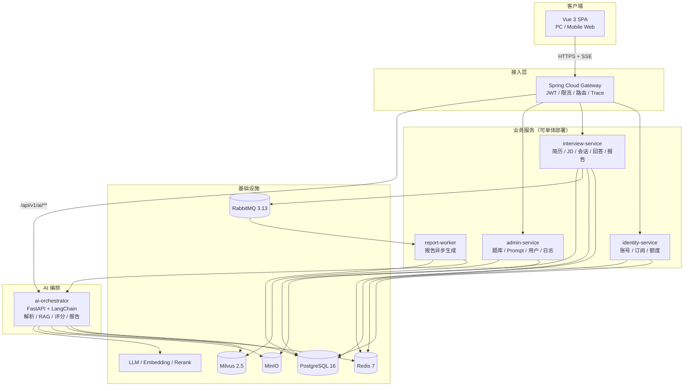

# 项目总览：产品与架构

> 状态：生效 ｜ 版本：v1.2 ｜ 更新：2026-11-07
> **什么时候读**：第一次接触项目，或要判断“这个功能属于哪一层 / 选型为什么这么定”时。
> 逐项展开：**要做什么** → [requirements.md](requirements.md)；**怎么设计** → [design/](design/)；**怎么干活** → [dev/](dev/)；**做到哪了** → [CHANGELOG.md](CHANGELOG.md)。

## 1. 产品定位

**OfferCoach** 是面向求职者的 AI 模拟面试与简历诊断平台。

用户上传简历、粘贴目标岗位 JD，系统生成**岗位针对性**的面试题；用户文字或语音作答，AI 逐题给出五维评分、原文证据与改进建议；结束后生成可复盘的面试报告与改进计划。

- **形态**：Web 产品（PC 为主、移动端可完成面试），SaaS 多用户，免费额度 + 订阅/次数包。
- **用户**：校招、社招、转岗人群；后续可扩展高校就业中心与企业招聘团队。
- **核心链路**：注册 → 上传简历 → 粘贴 JD → 创建模拟面试 → 逐题作答 → 流式评分 → 面试报告 → 历史复盘。
- **差异化**：
  1. 题目来自“简历 × JD”的缺口分析 + RAG 题库，不是通用题海；
  2. 评分必须有原文证据与可执行改写，拒绝空泛点评；
  3. 全链路可追溯：每道题可查“为什么问这题”，每题评分可查“引用哪句回答”；
  4. 成本可核算：单场 Token / 金额可计算，超预算可降级、可熔断。

功能范围以 [requirements.md](requirements.md) 为**唯一事实源**；业务规则与验收在 [design/product-requirements.md](design/product-requirements.md)；本文只描述当前形态与选型，不重复维护需求清单。

## 2. 端与部署形态

| 端 | 方案 | 状态 |
|---|---|---|
| PC Web | Vue 3 + Vite + TypeScript + Tailwind + shadcn-vue | 主力端，MVP |
| 移动 Web | 同一 SPA，响应式；面试房间 375px 可完成作答 | MVP |
| 语音作答 | MediaRecorder + ASR（V1.1） | 规划 |
| 管理端 | 同一 SPA 的 `/admin/*` 路由，独立布局与权限 | MVP |
| 小程序 / App | 不做；后续按增长需要评估 | 范围外 |

| 部署形态 | 组成 | 说明 |
|---|---|---|
| 本地开发 | Docker Compose：PG / Redis / RabbitMQ / Milvus / MinIO + 服务 + 前端 | 一键起；见 [ops/deployment.md](ops/deployment.md) |
| 预发 | Helm + 脱敏数据 + 真实 AI 小流量 | 跑 E2E、压测、迁移演练 |
| 生产 | K8s + Helm；Gateway 统一入口；AI 服务独立扩容 | 灰度发布；见 [ops/ci-cd.md](ops/ci-cd.md) |

## 3. 总体架构



要点：

- **业务后端先多模块单体、后拆微服务**：MVP 用一个 Maven 父工程，模块边界用 ArchUnit 强制；需要独立扩容时按模块拆出，不先交“分布式单体”的学费。
- **AI 编排独立 Python 服务**：RAG、评分、Prompt 与离线评测同仓，避免 Java/Python 两套 Prompt 漂移；Java 侧 LangChain4j 只做报告润色、管理端试跑与降级评分。
- **评分流网关直连 AI 服务**：少一跳；评分所需上下文在提交回答时预写入 Redis，SSE 请求零查库、零检索。
- **一套接口对所有端**：`/api/v1` REST + SSE；管理端复用同一鉴权与错误码体系。
- **报告异步**：RabbitMQ + 事务性 Outbox；报告失败可重试，不重复扣额度。

详细 ADR、服务职责、时序与容量估算见 [design/architecture.md](design/architecture.md)。

## 4. 技术选型与理由

| 领域 | 选型 | 版本基线 | 理由 |
|---|---|---|---|
| 前端框架 | Vue 3 + Vite + TypeScript | 3.5 / 6 / 5.6 | SFC 开发密度高；表单、会话流、图表为主；团队上手成本低 |
| UI | shadcn-vue（Reka UI）+ Tailwind CSS | 最新稳定 / 3.4 | 组件源码进仓库、可完全定制；可访问性由 Reka UI 保证 |
| 路由 / 状态 | Vue Router 4 / Pinia 2 / TanStack Query 5 | — | 路由守卫 + 客户端状态 + 服务端缓存分层 |
| 后端框架 | Spring Boot + Spring Cloud | 3.3.5 / 2023.0.3 | 事务、生态、微服务拆分路径成熟；团队 Java 沉淀 |
| AI（Java） | LangChain4j | 1.0.x | 轻量场景与降级链路；不作为评分权威实现 |
| AI（Python） | FastAPI + LangChain + pydantic | Python 3.12 | RAG / 评测生态；结构化输出与流式能力强 |
| 数据库 | PostgreSQL | 16 | 事务、JSONB、数组、分区；减少组件数量 |
| 缓存 | Redis | 7.2 | 额度快速拒绝、限流、评分上下文、幂等缓存 |
| 消息 | RabbitMQ | 3.13（quorum queue） | 报告异步、通知；Outbox 保证不丢消息 |
| 向量库 | Milvus | 2.5 | 稠密 + 稀疏混合检索 + RRF；题库增长不换栈 |
| 对象存储 | MinIO（S3 API） | 最新稳定 | 本地与云上一致；预签名下载 |
| 观测 | OpenTelemetry + Prometheus + Grafana + Loki | — | Trace / Metrics / Logs 三件套 |
| 部署 | Docker Compose + K8s + Helm | — | 本地一键起，生产可灰度与弹性 |

**已否决候选（留痕）**：

- **React**：并非不可行；本项目页面形态以表单与会话流为主，团队 Vue 沉淀更深，选择 Vue 降低交付风险。若团队 React 更强，可替换，架构与接口不变。
- **纯 Spring Boot 单体，不拆 AI 服务**：LangChain4j 的 RAG / 评测生态弱于 Python，Prompt 与评测会分裂；否决。
- **全量微服务从第一天开始**：团队规模与流量不支持，分布式事务、联调、部署成本过高；改为多模块单体 + 明确拆分触发条件。
- **Elasticsearch + 向量插件**：多一套集群与运维；Milvus 的混合检索已满足 10 万级题库。
- **WebSocket 做评分流**：评分是单向、短时推送，SSE 更简单，代理穿透与重连更成熟；双向语音对话才需要 WebSocket。
- **Tailwind 任意值写设计**：会绕开 Design Token，导致主题与暗色模式失控；禁止。

## 5. 后端分层、横切与认证

```
controller   # 协议层：参数校验、鉴权注解、DTO、HTTP 语义
service      # 应用层：用例编排、事务边界、幂等、跨聚合协调
domain       # 领域层：状态机、额度规则、评分加权
repository   # 持久化：CRUD、行锁、分页
client       # 外部调用：AI、身份、支付；超时/重试/熔断
```

- **Controller 不写规则**，Service 不返回 Entity，Repository 不调用外部服务。
- **统一错误信封** `{code, message, requestId, traceId, details}`；业务异常必须带错误码。
- **认证**：JWT RS256（Access 15min）+ Refresh Cookie（7d，轮换）；网关校验，服务内再校验资源归属。
- **横切**：TraceId 全链路、结构化日志、审计日志、幂等拦截、限流、额度锁。
- **AI 调用**：业务事务内禁止长耗时调用；先提交事务，再调用或发消息。

细节见 [dev/backend.md](dev/backend.md) 与 [design/api.md](design/api.md)。

## 6. 非功能目标

| 维度 | 目标 |
|---|---|
| 首 Token | 评分 SSE P95 < 1000ms；首句 P95 < 2000ms |
| 普通 API | P95 < 300ms，P99 < 800ms |
| 出题 | P95 < 15s；首题 P95 < 5s |
| 报告 | P95 < 30s；硬超时 90s |
| 可用性 | 99.5%/月；AI 故障进入降级模式 |
| 并发 | 200 路 SSE；单实例 50 路 |
| 成本 | 单场 ≤ ¥0.30（按配置单价）；三级熔断 |
| 安全 | OWASP Top 10；越权、注入、上传、SSE 滥用防护 |
| 隐私 | PII 最小化、可删除、不用于训练 |

## 7. 推进顺序

按依赖与风险推进，不按“功能清单”平均用力：

1. **地基**：工程骨架、CI、Compose、账号、额度流水、可观测性。
2. **输入**：简历解析、JD 结构化与匹配（先打通真实文件与结构化输出）。
3. **会话与出题**：状态机、题库导入/向量化、混合检索、出题校验。
4. **评分流**：提交回答、上下文快照、SSE、反馈落库、首字监控。
5. **报告与额度**：Outbox、Worker、报告页、对账。
6. **管理端与评测**：题库、Prompt 版本、灰度、黄金集、调用日志。
7. **硬化**：压测、安全、降级演练、UAT、灰度。

详细排期与 DoD 见 [dev/roadmap.md](dev/roadmap.md)。